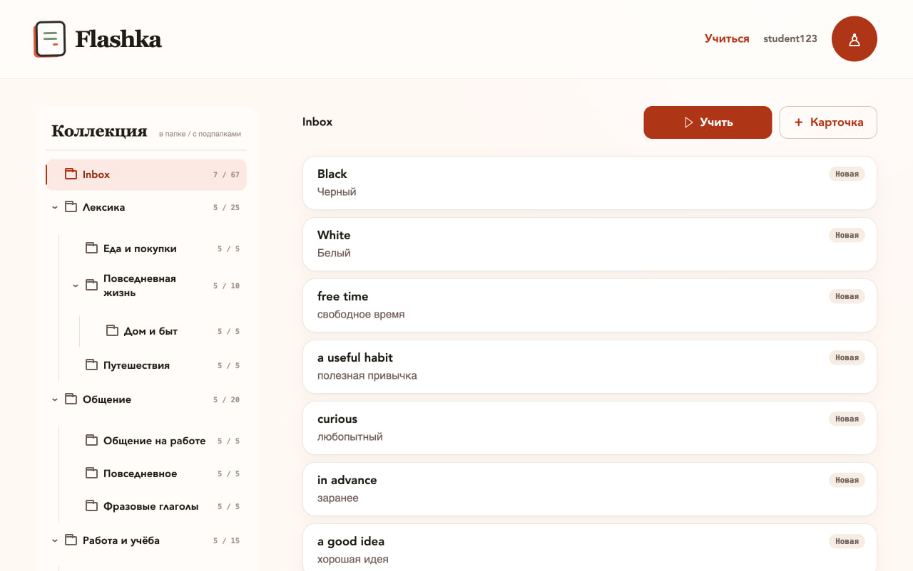

<div align="center">

# Flashka

**Запоминайте важное. Возвращайтесь к нему вовремя.**

Текстовые флеш-карточки и интервальное повторение — в браузере, на компьютере и телефоне.

[](https://github.com/Skifskii/flashka/actions/workflows/ci.yml) [](LICENSE) [](docs/ROADMAP.md)

[Быстрый старт](#быстрый-старт) · [Возможности](#возможности) · [Документация](#документация) · [Участие](#участие)

</div>



Flashka помогает превратить материал в карточки и закреплять его короткими учебными сессиями. Сохраните мысль в Inbox, разложите карточки по папкам и начните повторение — приложение само рассчитает расписание и сохранит прогресс.

> **Проект в разработке.** Основные сценарии MVP реализованы; общая проверка перед пилотом ещё предстоит. Публичных стабильных релизов пока нет. Текущее состояние — в [roadmap](docs/ROADMAP.md).

## Возможности

|                           |                                                                                                                   |
| ------------------------- | ----------------------------------------------------------------------------------------------------------------- |
| **Сохраняйте знания**     | Две текстовые стороны для любого материала: вопрос и ответ, термин и определение.                                 |
| **Наводите порядок**      | Inbox для быстрых заметок, дерево папок и перемещение карточек.                                                   |
| **Повторяйте регулярно**  | Сессии по всей коллекции или папке с подпапками, открытие оборота и самооценка ответа. Расписание считает сервер. |
| **Следите за прогрессом** | Статусы карточек, итоги обучения и продолжение сессии после перезагрузки.                                         |
| **Учитесь где удобно**    | Адаптивный интерфейс с кнопками, клавиатурой и жестами. Личное пространство со входом по логину и паролю.         |

В MVP нет восстановления пароля, email, импорта/экспорта, публичных наборов, медиа и офлайн-режима. Сохраните свой пароль при регистрации.

## Быстрый старт

Нужны **Go 1.24+**, **Node.js 24**, npm, Docker с Compose v2 и Make. Для приведённых команд используйте POSIX-совместимую оболочку; на Windows — WSL2. Docker должен быть запущен, порты `5432` и `8080` — свободны. Рабочий код сейчас находится в ветке `mvp`:

```sh
git clone --branch mvp https://github.com/Skifskii/flashka.git
cd flashka
make dev
```

Команда поднимает PostgreSQL 17, применяет миграции, устанавливает npm-зависимости, собирает frontend и запускает Go-сервер. Используйте адрес, который она выведет: при наличии сетевого IP это адрес компьютера в локальной сети, доступный и с телефона в той же Wi-Fi-сети; иначе — `http://localhost:8080`. Зарегистрируйте аккаунт в интерфейсе — демонстрационных учётных записей нет.

`Ctrl+C` останавливает приложение. `make db-down` останавливает PostgreSQL; данные остаются в Docker volume между запусками.

### Конфигурация

Стандартный запуск работает без `.env`. Доступные настройки и локальные значения приведены в [.env.example](.env.example). Приложение и Make **не загружают `.env` автоматически**. Чтобы использовать свой файл:

```sh
cp .env.example .env
# Отредактируйте .env, затем экспортируйте значения в текущую оболочку:
set -a
. ./.env
set +a
make dev
```

`TRUSTED_ORIGIN` должен совпадать с origin, на котором открыт интерфейс. Без явного значения `make dev` выбирает адрес локальной сети, если он доступен. Для запуска только на этом компьютере можно явно задать:

```sh
HTTP_ADDR=127.0.0.1:8080 TRUSTED_ORIGIN=http://localhost:8080 make dev
```

Учётные данные `flashka:flashka` в Compose — только для локальной разработки. `DATABASE_URL` меняет подключение приложения, но не учётные данные контейнера: при внешней БД настройте их отдельно. Для публичного развёртывания нужны HTTPS, `APP_ENV=production`, соответствующий `TRUSTED_ORIGIN`, отдельные секреты и резервное копирование БД. Подробнее — [конфигурация и развёртывание](docs/ARCHITECTURE.md#10-конфигурация-и-развёртывание).

## Разработка

Backend — модульный монолит на Go с PostgreSQL и серверными сессиями. Frontend — React 19, TypeScript и Vite. REST API описан в [OpenAPI](api/openapi.yaml). Redis, очереди и микросервисы не используются.

| Путь          | Содержимое                                           |
| ------------- | ---------------------------------------------------- |
| `cmd/`        | HTTP-сервер и CLI миграций                           |
| `internal/`   | Auth, карточки, папки, обучение и платформенный код  |
| `migrations/` | Версионированные SQL-миграции                        |
| `web/`        | React-приложение, component-тесты и Playwright smoke |
| `api/`        | Контракт HTTP API                                    |
| `docs/`       | Требования, архитектура, roadmap, specs и ADR        |

`make dev` раздаёт собранный frontend. Для разработки с hot reload оставьте backend запущенным и во второй оболочке выполните:

```sh
cd web
npm run dev
```

Vite доступен на `http://localhost:5173` и проксирует API на backend `:8080`. Для этого режима запустите backend с `TRUSTED_ORIGIN=http://localhost:5173`.

### Проверки

После `make dev` frontend-зависимости уже установлены. Для проверок без запуска приложения сначала выполните `cd web && npm ci`.

| Команда              | Назначение                                                      |
| -------------------- | --------------------------------------------------------------- |
| `make fmt-check`     | Форматирование Go и frontend                                    |
| `make lint`          | Go vet, ESLint и TypeScript typecheck                           |
| `make test`          | Go race/unit и frontend component-тесты                         |
| `make openapi-check` | Валидация OpenAPI                                               |
| `make secret-check`  | Поиск распространённых шаблонов секретов в отслеживаемых файлах |
| `make build`         | Production-сборка frontend и Go binary в `bin/flashka`          |
| `make check`         | Все перечисленные выше проверки и сборка                        |

`make test-integration` требует работающей PostgreSQL с применёнными миграциями (`make db-up migrate-up`). Используйте отдельную тестовую БД: тесты меняют данные. `make migrate-check` выполняет **разрушительный цикл down/up**; запускайте его только на одноразовой БД.

Для E2E установите браузер: `cd web && npx playwright install --with-deps chromium`, затем выполните `make test-e2e` из корня с доступной тестовой БД и миграциями. Playwright запускает отдельный backend на порту `18080`; порт должен быть свободен. Полный набор проверок также настроен в [GitHub Actions](.github/workflows/ci.yml).

## Участие

Исправления и предложения принимаются через [Issues](https://github.com/Skifskii/flashka/issues) и pull requests. Перед началом прочитайте [CONTRIBUTING.md](CONTRIBUTING.md). Об уязвимостях сообщайте по [политике безопасности](SECURITY.md).

Основная документация и интерфейс сейчас на русском; Issues и PR можно писать на русском или английском.

## Документация

- [Продуктовая спецификация](docs/PRODUCT.md) — сценарии и границы MVP.
- [Архитектура](docs/ARCHITECTURE.md) — модули, данные и технические решения.
- [Процесс разработки](docs/DEVELOPMENT.md) — срезы и выбор проверок.
- [Roadmap](docs/ROADMAP.md) — статус и дальнейшие шаги.
- [Инструкции агентам](AGENTS.md) — правила работы с репозиторием.

## Лицензия

Проект распространяется под лицензией [MIT](LICENSE).
